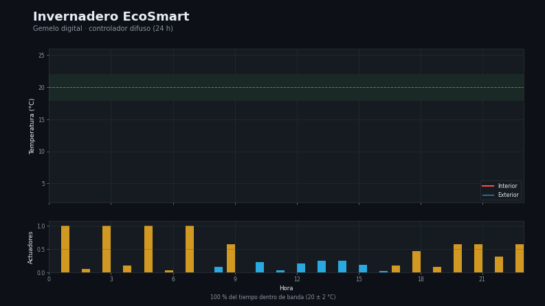

# Capa 7 — Control climático e IoT (gemelo digital)

[`lazarolpro/invernadero-ecosmart`](https://github.com/lazarolpro/invernadero-ecosmart) · parte del [portafolio de 9 capacidades](https://github.com/lazarolpro/portafolio)

**Capacidad demostrada:** mantener una variable de proceso (temperatura) dentro de
su banda de confort con un **controlador difuso** sobre un modelo térmico, decidiendo
los actuadores (calefacción y ventilación).

> © 2026 Ronny L. Díaz López. **Todos los derechos reservados.** El código fuente,
> los datos de detalle y los informes completos son propiedad del autor y no se
> publican. Prohibida su venta o uso comercial sin autorización escrita. Ver
> [`LICENSE`](LICENSE).

## Problema real

Un invernadero se enfría de noche y se sobrecalienta al mediodía. Sin control
automático hay que regular a mano y el cultivo sufre; con control mal ajustado se
gasta energía de más. Un **gemelo digital** permite probar el lazo de control antes
de instalar un solo sensor.

## Qué hace

- Integra un **modelo térmico** (inercia, pérdida por envolvente, aporte solar,
  calefacción y ventilación) desde un perfil horario de clima.
- Aplica un **controlador difuso tipo Mamdani** (cinco conjuntos triangulares sobre
  el error térmico) que decide calefacción y ventilación.
- Emite el porcentaje de tiempo dentro de banda y la energía de calefacción
  acumulada.

## Demo visual

La animación recorre las 24 h: temperatura, consigna y actuadores. Video completo:
[`assets/invernadero_demo.mp4`](assets/invernadero_demo.mp4).

## Evidencia que produce

- `assets/invernadero_demo.mp4`, `invernadero_demo.gif`, `invernadero_demo_poster.png`
  — demo visual animado (con miniatura).
- [`assets/muestra_invernadero.pdf`](assets/muestra_invernadero.pdf) — muestra
  resumida del informe de simulación (con marca de agua).
- [`data/clima_24h.csv`](data/clima_24h.csv) — perfil de clima de entrada.
- [`data/simulacion.json`](data/simulacion.json) — traza de la simulación.

## Alcance de este repositorio

Este repositorio es una **vitrina del resultado**: muestra el lazo de control y su
desempeño. El **código fuente** y los **informes completos** son propiedad del autor
y se mantienen fuera del repositorio público. El proyecto EcoSmart real añade una
regresión Ridge, un LLM local supervisor (Ollama) y datos de MeteoGalicia.

## Stack

Python 3 (solo biblioteca estándar: `csv`, `json`, `math`). Sin dependencias.
*(El código no se publica; ver `LICENSE`.)*

## Por qué le importa a la empresa

Cubre **control de procesos e IoT**: el mismo patrón (medir → modelar → decidir →
actuar) sirve para climatización, riego o cualquier lazo de control industrial.

**En mantenimiento:** permite ajustar y validar un lazo de control sin tocar el
equipo real, y detectar cuándo un actuador no responde como debería.
